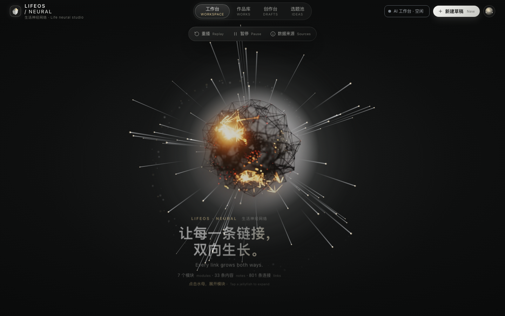

# LifeOS Local

**AI 梦幻工作台 · 本地优先的个人知识库可视化面板**

把你的 Markdown 笔记变成一张会呼吸的神经网络：中心一颗光球，五只发光的水母代表作品库、概念网络、方法库、选题池和创作台，触须连到每一篇内容；配一个能读懂这些笔记的本地大模型。

数据全程留在你自己的电脑上，不需要账号，不联网也能跑。

<p>

</p>

[](LICENSE)
[](frontend/LICENSE)
[](https://nodejs.org)
[](#模型本地还是云端)

> 关键词：AI 梦幻面板 · 工作台可视化 · 数据可视化看板 · 个人知识库 · 第二大脑 · 本地优先 · 神经网络可视化 · 知识图谱 · 笔记蒸馏 · Ollama · 私有化 AI

## 目录

- [它能做什么](#它能做什么)
- [快速开始](#快速开始)
- [换成你自己的笔记](#换成你自己的笔记)
- [数据在哪里](#数据在哪里)
- [模型：本地还是云端](#模型本地还是云端)
- [后端能力](#后端能力)
- [技术栈](#技术栈)
- [项目结构](#项目结构)
- [授权](#授权)
- [English](#english)

## 它能做什么

- **梦幻工作台**：光球点亮、粒子迸发，背景网络从中心蔓延；五只水母（作品库、概念网络、方法库、选题池、创作台）围绕光球游动。纯 Canvas 绘制，不依赖显卡。
- **三层交互**：点水母 → 光球退到左侧、水母列队、触须扇形展开到该模块每一篇内容；点内容 → 右侧滑出分析栏（指标、出链 / 反链 / 双向、相关话题）；Esc 逐层返回。
- **双向链接**：`[[笔记名]]` 自动解析成节点连线，反向链接、二度关联一次算清。
- **问你的图谱**：底部对话框可问「最核心的内容」「双向连接有哪些」「下一篇写什么」，本地规则检索，不调用 API。
- **笔记蒸馏**：把一个月的记录压缩成可复用的技能卡（`vault/agents/skills/`），下次对话自动挂载参考。
- **本地大模型对话**：默认接 Ollama，流式输出；可选接云端模型（OpenAI 兼容格式），不配就完全离线。
- **进度与成长面板**：记录量、连续天数、身体与学习轨迹，数据来自真实笔记，不是填表。
- **资料管理**：正文搜索、Markdown 编辑、归档，保存前留版本。
- **中英双语**，尊重系统「减少动态效果」设置。

## 快速开始

需要 Node.js ≥ 20.19。三步：

```bash
git clone https://github.com/okeya24/lifeos-local-first.git
cd lifeos-local-first
./start.sh
```

Windows 或想手动执行：

```bash
npm install
npm run build     # 首次会安装界面依赖并构建
npm start
```

打开 <http://127.0.0.1:8787>。界面自带**虚构示例数据**，不装模型也能看效果。

想聊天，先起本地模型：

```bash
ollama pull qwen2.5:7b     # 或任何你喜欢的模型
cp .env.example .env       # 按需改 OLLAMA_MODEL
```

## 换成你自己的笔记

界面默认读示例数据。导入自己的笔记：

```bash
npm run import -- --vault ./vault
npm run build
```

- 只读 Markdown，不修改、不上传你的文件
- 生成 `frontend/src/data/my-data.js` 作为快照，已被 `.gitignore` 排除
- 切回示例：`npm run import -- --reset`

你的笔记本身放在 `vault/`（或任意目录，见下一节）。

## 数据在哪里

```text
vault/
├── 00 收件箱/       随手记、待整理
├── 10 每日/         每日记录
├── 20 身体/         睡眠、训练
├── 30 认知/         复盘、决策、情绪
├── 40 学习/         资料、概念卡
├── 50 工作与项目/
├── 70 方向与愿景/
├── 90 归档/
├── agents/          人格、偏好、技能（蒸馏产物）
└── 待蒸馏/
```

每篇都是普通 Markdown，带 YAML front-matter。**已有一堆笔记不想搬？** 把整个笔记目录做成软链接即可：

```bash
mv vault vault.demo
ln -s ~/Documents/我的笔记 vault
```

仓库里自带的 `vault/` 全部是虚构的演示数据（一个不上班的独立开发者视角），随便改随便删。

## 模型：本地还是云端

| | 本地（默认） | 云端（可选） |
|---|---|---|
| 配置 | 装 Ollama，拉一个模型 | 填 `CLOUD_API_KEY` |
| 隐私 | 数据不出机器 | 对话上下文会发到服务商 |
| 成本 | 免费 | 按量计费 |

不配云端 Key 时，普通对话、蒸馏全部走本地，界面里也不会出现需要联网的入口。

## 后端能力

`server/` 是一个 Express 服务，除了托管界面还负责：

- **对话与 Agent**：流式输出、工具调用循环、任务上下文、取消
- **笔记读写**：front-matter 解析、正文搜索、版本备份、归档
- **蒸馏链路**：素材 → 摘要 → 技能卡草稿 → 你验收后才启用
- **文件整理协议**：必须先给出方案，回复「确认执行 P方案ID」才动文件，日志落盘
- **进度统计**：活动心跳、连续天数、成长报告

自动化测试（8 项，覆盖文件协议、技能触发、蒸馏状态机）：

```bash
npm test
```

## 技术栈

后端 Node 20 + Express 5 + gray-matter；界面 React 19 + Vite 7 + Canvas 2D；数据是纯 Markdown；模型走 Ollama 或任何 OpenAI 兼容端点。

整个项目只有 2 个运行时依赖，没有数据库，没有 Docker。

## 项目结构

```text
server/      Express 服务、模型适配、蒸馏与进度接口
frontend/    神经网络界面（React + Vite，独立目录、独立许可）
tests/       node:test 用例
data/        首页演示数据
docs/        架构、部署、语音、进度口径
vault/       你的 Markdown 笔记（自带的是虚构示例）
dist/        构建产物，不提交
```

## 授权

**分区授权，请先看清目录：**

- 根目录 `server/`、`scripts/`、`tests/`、`data/`、`docs/` —— **MIT**，可商用
- `frontend/` —— 基于 [neural-creator-dashboard](https://github.com/luoluo-121/neural-creator-dashboard)（作者 luoluo-121）修改，**PolyForm Noncommercial 1.0.0**，仅限非商业使用
- `vault/` 示例数据 —— CC BY 4.0

**要用界面做商业产品，需向原作者取得授权**；后端 MIT 部分不受此限制。详见 [NOTICE.md](NOTICE.md)。

## English

**LifeOS Local** is a local-first personal growth workbench. Your Markdown notes become a living neural dashboard: a glowing orb, five jellyfish modules, bi-directional links and a per-note analysis panel — rendered with Canvas 2D, no GPU needed.

- **Dreamy visual workbench** — orb, particles, jellyfish and tentacles as a navigable map of your knowledge
- **Two-way links** — `[[wiki links]]` resolved into a graph, backlinks and second-degree relations
- **Note distillation** — monthly logs compressed into reusable skill cards
- **Private AI chat** — Ollama by default, OpenAI-compatible endpoints optional, fully offline without a key
- **Markdown in, Markdown out** — no database, no lock-in, 2 runtime dependencies

```bash
git clone https://github.com/okeya24/lifeos-local-first.git
cd lifeos-local-first && ./start.sh
```

Open <http://127.0.0.1:8787>. Ships with fictional demo data.

Licensing is split: backend is MIT, the `frontend/` directory is PolyForm Noncommercial 1.0.0 (derived from neural-creator-dashboard by luoluo-121). See [NOTICE.md](NOTICE.md).

---

如果这个项目对你有用，点个 Star 就是最好的支持。
